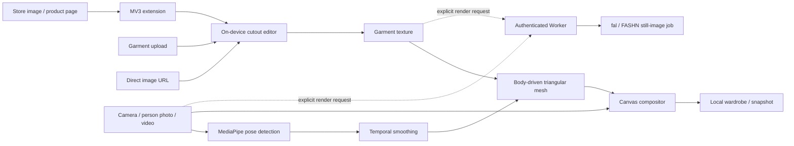

# Architecture and growth path

## Runtime boundaries

- **React frontend:** interface, source selection, explicit user actions, local wardrobe and errors.
- **Media engine:** tracking model lifecycle, pose smoothing, mesh geometry, texture preparation, image cutout, camera lifecycle and rendering.
- **Extension:** `activeTab` user-initiated image picking; optional per-host import permissions; isolated fitting window. No persistent content script on every visited page, no credentials included in image requests, no arbitrary script execution from store markup.
- **Static delivery:** GitHub Pages/CDN. Models and WebAssembly are self-hosted. Camera/video frames are processed locally; no server compute is required per active browser session.
- **Optional Worker:** bounded authenticated render jobs, secrets confined to server, KV-stored job URLs, submission limits, provider errors. It is not required by the browser engine.

## Performance

Pose detection is throttled to approximately 20 inferences per second, depending on device capability; rendering uses requestAnimationFrame. The current MediaPipe API runs synchronous inference on the main thread. It prefers GPU where supported and falls back to CPU. The renderer uses a 12×16 mesh and caps frame resolution at 1280 pixels on its longest edge. Image editing caps inputs at 1024 pixels. Frame output and tracking confidence are measured, not fabricated.

For high-end production, move inference to a dedicated worker (with device compatibility testing), profile lower-end phones, add adaptive resolution and thermal throttling, and consider WebGL mesh rendering. Do not claim an unmeasured frame-rate target.

## Scaling honestly

Static delivery and local inference avoid a centralized per-frame server bottleneck. That does not establish billion-user readiness. Before commercial rollout, perform device/browser coverage, WCAG and security audits, extension-store review, automated production smoke checks, error monitoring with explicit privacy rules, abuse protection, and load/billing tests for the optional backend. See `server/README.md` for multi-user service requirements.

Physical sizing needs reliable body measurements, garment measurement charts, fabric properties and a validated fit model. Photorealistic generated live video needs a GPU inference architecture, latency/temporal-consistency evaluation, provider or model licensing, and substantial additional validation.
